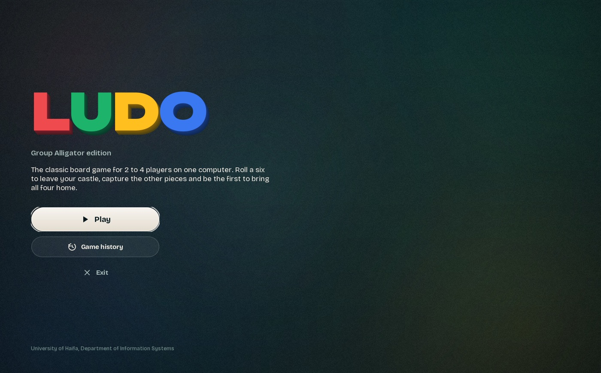
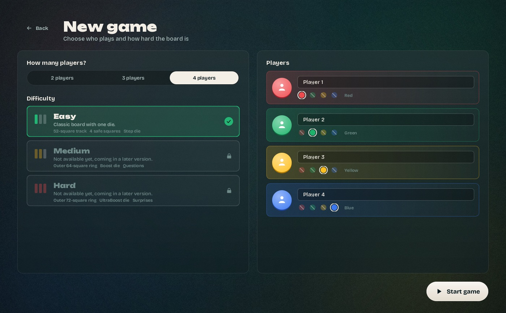
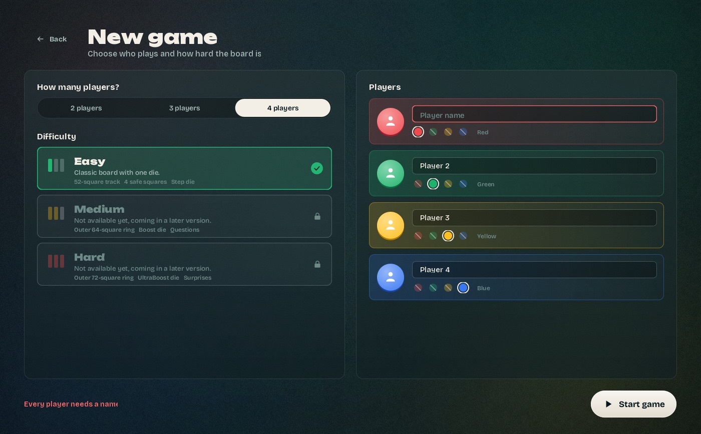
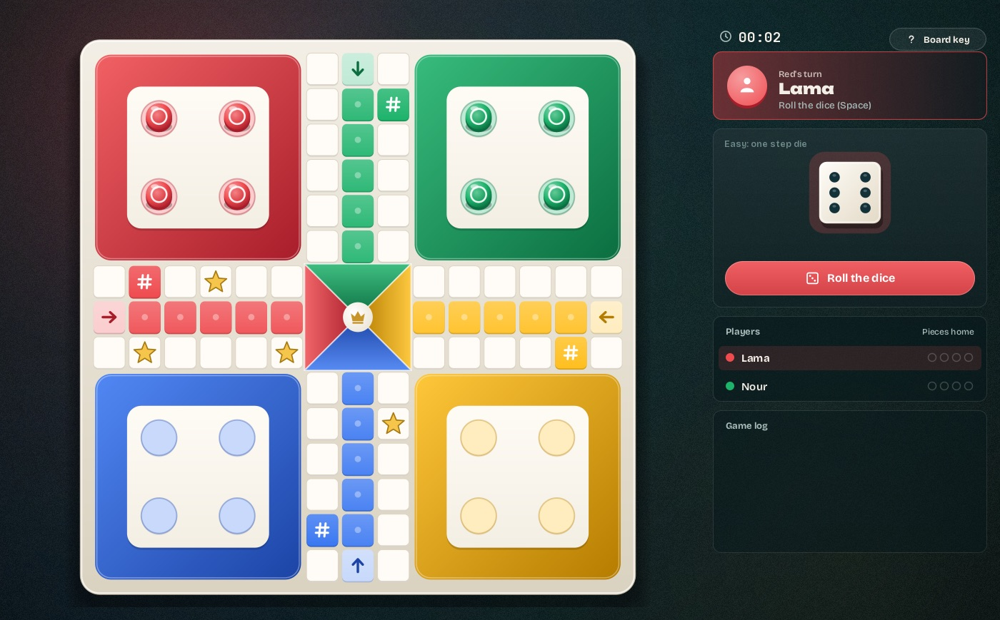
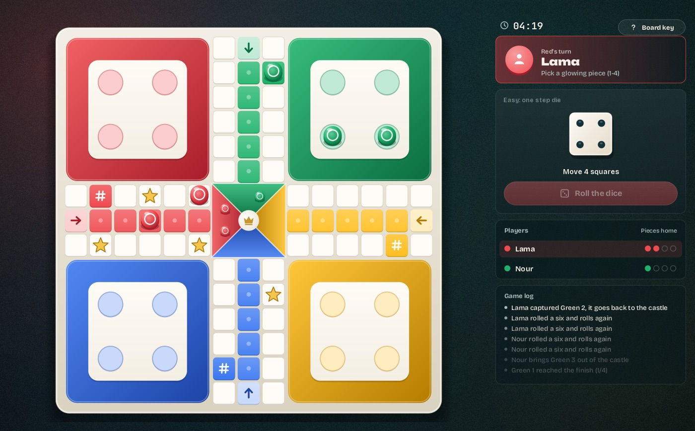
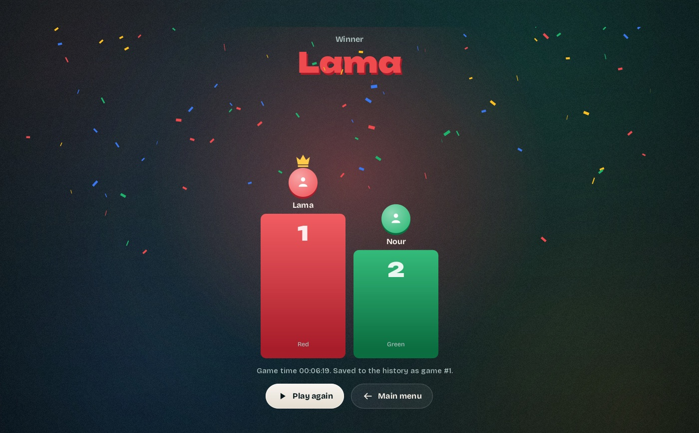
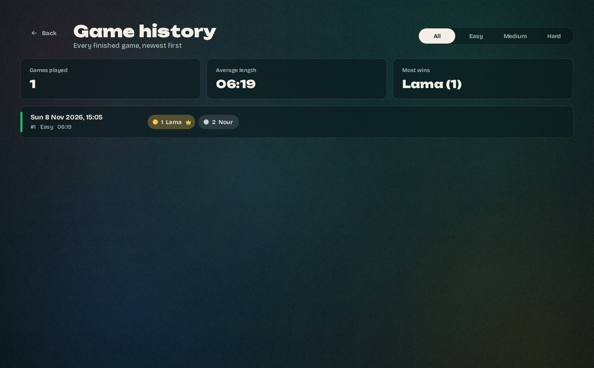

# Iteration 1 – Acceptance test (T1.13)

Tester: Lama Zbedat (PO)
Date: 08/11/2026
Build: `dist/Ludo_Alligator.jar` from `main` after PR #12 (all tasks T1.1–T1.12 merged)
Machine: macOS, Java 21 (jar compiled for Java 17)

Each user story from SDP 5.2.1 was checked against its SRS requirements. A story passes when every
check below passes.

## US-1 – Set up a game (P-SET-1 to 5)

| # | Step | Expected | Result |
|---|---|---|---|
| 1.1 | Start the jar | Home screen within 5 s (PER-1) | Pass |
| 1.2 | Press **Play** | Setup screen opens (P-SET-1) | Pass |
| 1.3 | Choose 2 / 3 / 4 players | rows for that many players; only Easy can be picked this iteration (P-SET-2) | Pass |
| 1.4 | Pick a color another player has | it is crossed out and can't be picked (P-SET-3) | Pass |
| 1.5 | Clear a name, press **Start game** | game doesn't start, "Every player needs a name", field marked red (P-SET-4) | Pass |
| 1.6 | Two players "Lama" and "lama" | "Two players can't have the same name" (P-SET-3) | Pass |
| 1.7 | Valid setup with Green and Red | board opens, Red plays first (P-SET-5) | Pass |

## US-2 – See the board and whose turn it is (P-BRD-1, 4, 6, 7; P-DIC-1)

| # | Step | Expected | Result |
|---|---|---|---|
| 2.1 | Look at the board | cross board, 52-square track, 4 castles, 5 home squares per color, finish in the middle (P-BRD-1) | Pass |
| 2.2 | Start squares and arrows | in the same place every game (P-BRD-4) | Pass |
| 2.3 | Special squares | `#`, star and arrow symbols, not only color (P-BRD-6) | Pass |
| 2.4 | Follow a piece round the board | start → clockwise → own arrow → home column → finish (P-BRD-7) | Pass |
| 2.5 | During the game | turn card always shows the current player's name and color (P-DIC-1) | Pass |

## US-3 – Roll and move pieces to the finish (P-DIC-2, 3, 5, 7, 8; P-MOV-1 to 4)

| # | Step | Expected | Result |
|---|---|---|---|
| 3.1 | Press Space twice fast | only one roll (P-DIC-2, REL-1) | Pass |
| 3.2 | Roll 1–5 with all pieces in the castle | log says "needs a six", turn passes by itself (P-DIC-7, P-MOV-1) | Pass |
| 3.3 | Roll a 6 | piece can come out, then the same player rolls again (P-MOV-1, P-DIC-5) | Pass |
| 3.4 | Roll with several options | movable pieces glow, hover shows where they land (P-DIC-8) | Pass |
| 3.5 | Move a piece on the track | moves exactly the roll (P-MOV-2) | Pass |
| 3.6 | Piece 3 squares before the finish, roll 5 | that piece can't move (P-MOV-4) | Pass |
| 3.7 | Same piece, roll 3 | reaches the finish (P-MOV-3, P-MOV-4) | Pass |

## US-4 – Capture other pieces (P-MOV-5)

| # | Step | Expected | Result |
|---|---|---|---|
| 4.1 | End a move on a lone opponent on a normal square | it goes back to its castle, log says who captured whom | Pass |
| 4.2 | End a move on an opponent on a star or start square | no capture | Pass |

## US-5 – See the results and save the game (P-END-1 to 5; DB-1, 3)

| # | Step | Expected | Result |
|---|---|---|---|
| 5.1 | A player brings all 4 pieces home | gets 1st place and is skipped after that (P-END-1) | Pass |
| 5.2 | Only one player left | game ends, that player is last (P-END-2) | Pass |
| 5.3 | Results screen | every place with name and color, game time (P-END-3) | Pass |
| 5.4 | Open `data/history.csv` | header is the course template's, one row per game (P-END-4, DB-1) | Pass |
| 5.5 | Make `history.csv` read-only, finish a game | results still shown, red error under them (P-END-5) | Pass |

Row written by the full test game:
```
1,easy,08/11/2026;15:05:43,Lama,Nour,,,00:06:19
```

## US-6 – See old games (P-HIS-1; REL-2)

| # | Step | Expected | Result |
|---|---|---|---|
| 6.1 | Home → **Game history** | all games, newest first, with date, difficulty, order and duration (P-HIS-1) | Pass |
| 6.2 | Add a broken line to `history.csv` | that line is skipped, the other games still show (REL-2) | Pass |
| 6.3 | **Back** | Home screen | Pass |

## Full game

One complete 2-player game (Lama vs Nour) played on the jar, keyboard only (Space and 1–4):
139 rolls, 123 moves, 24 sixes, 1 capture, 6:19 game time. It ended on the Results screen and was saved
as game #1.

| Home | Setup | Setup error |
|---|---|---|
|  |  |  |

| Board | After a capture | Results | History |
|---|---|---|---|
|  |  |  |  |

## Result

All six stories (US-1 to US-6) pass. Iteration 1 is accepted by the PO.

Still open for the submission: T1.14, running the jar on a Windows computer.
