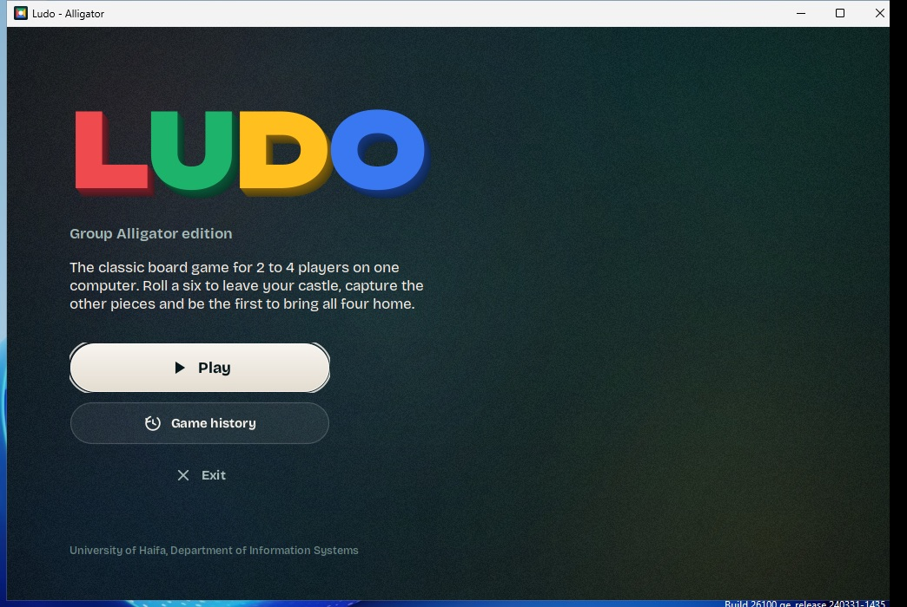
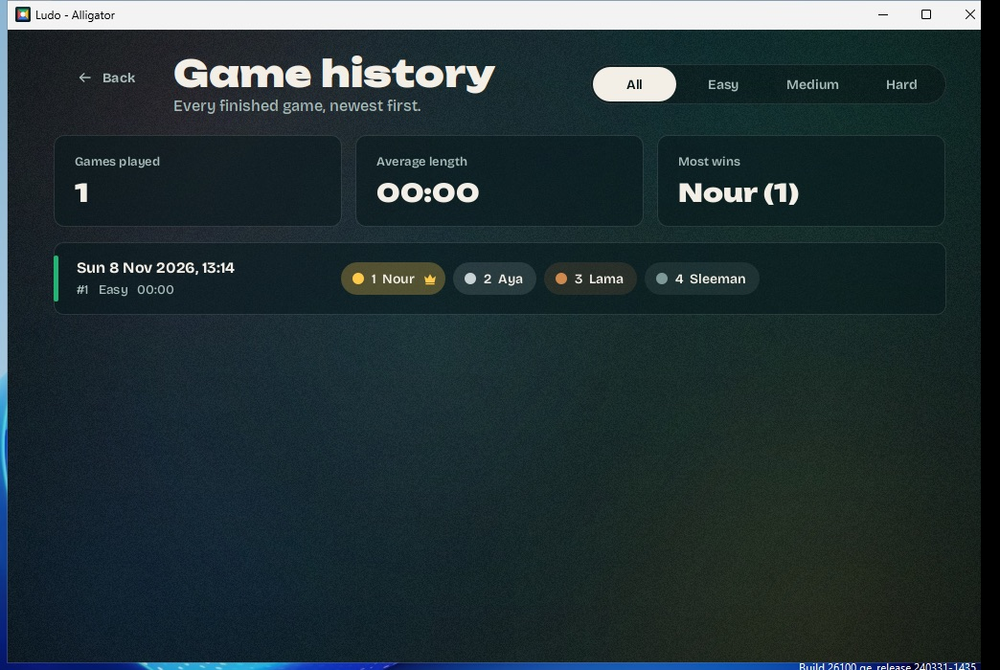
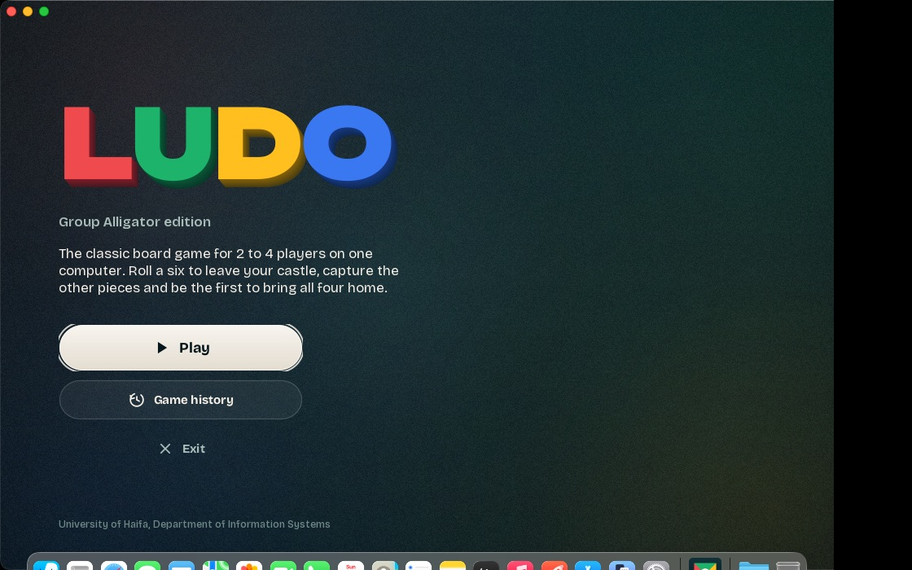
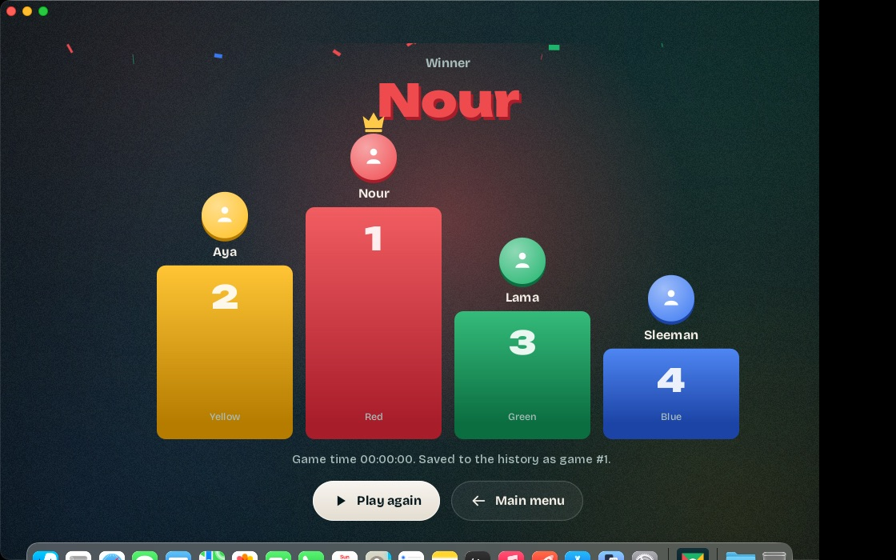
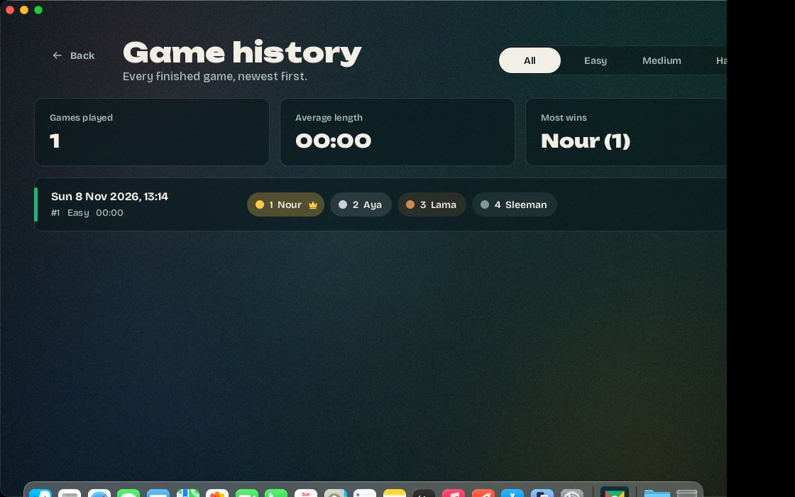

# Iteration 1 – Jar test on Windows and macOS (T1.14)

Tester: Nour Alden Mousa (SM)
Date: 08/11/2026
Risk: R4 in the SDP (a jar that doesn't run gets 0)

We work on Macs, so the Windows test runs on a GitHub Actions Windows machine
(`.github/workflows/jar-check.yml`). It runs on every push to `main` and on every pull request.

## What is tested

1. The **committed** jar `dist/Ludo_Alligator.jar` (the one we hand in) is copied to an empty folder
   and `ci/JarSmokeTest.java` runs against it:
   - 50 games with 2, 3 and 4 players, all must end with a full ranking
   - the real window opens on Home, a finished game goes through the Results screen and History screen
   - `data/history.csv` is made **next to the jar**, with the course header, one row, CRLF line endings
2. `build.bat` (Windows) / `build.sh` (macOS) build the jar from the sources.
3. `run.bat` / `run.sh` start the game, and it is still running after 12 seconds.

## Result

Run: https://github.com/b14ckPanther/Ludo_Alligator/actions/runs/42483972442

| Check | Windows Server 2025, Java 17.0.21 | macOS 26.7, Java 17.0.21 |
|---|---|---|
| 50 games end with a full ranking | Pass (50/50) | Pass (50/50) |
| window opens, Results and History screens show | Pass | Pass |
| `data\history.csv` next to the jar | Pass (`D:\a\...\smoke\data\history.csv`) | Pass |
| header = course template header | Pass | Pass |
| one row, game number 1 | Pass | Pass |
| CRLF line endings | Pass | Pass |
| build script makes the jar | Pass (`build.bat`) | Pass (`build.sh`) |
| launch script starts the game | Pass (`run.bat`) | Pass (`run.sh`) |

Row written on Windows:
```
1,easy,08/11/2026;13:12:43,Nour,Aya,Lama,Sleeman,00:00:00
```
(The duration is 0 because the test plays the game in code, without waiting for animations.)

## Bug found and fixed

The first Windows run showed the text on the Home screen cut off at the right. Windows draws that text
wider than macOS, and the HTML wrap width didn't follow it. Home now uses `Text.wrapping()`, which wraps
at the width the text really gets. The next Windows run shows it correctly.

## Note

The Windows test machine has a 1024x768 screen, smaller than the 1280x720 minimum in SRS 3.1.2, so the
window is a bit wider than the screen there. On a normal laptop screen the whole window fits.

## Screenshots

| | Home | Results | History |
|---|---|---|---|
| Windows |  |  |  |
| macOS |  |  |  |
